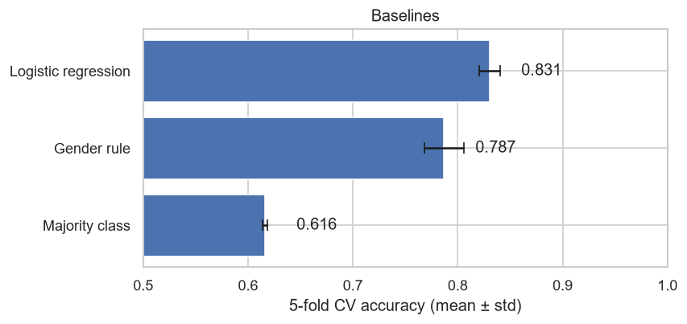

# Titanic: Machine Learning from Disaster

End-to-end tabular ML project on the Kaggle
[Titanic](https://www.kaggle.com/competitions/titanic) competition:
predict which passengers survived the sinking (binary classification, scored by accuracy).

> Work in progress. This README is filled in as each step is finished.

## Approach

| Step | Status | Where |
|---|---|---|
| 1. Exploratory data analysis | done | `notebooks/01_eda.ipynb` |
| 2. Baseline (logistic regression) | done | `notebooks/02_baseline.ipynb` |
| 3. Tree models (Random Forest, XGBoost) | planned | |
| 4. Cross-validation and model selection | planned | |
| 5. Kaggle submission | planned | `submissions/` |

## Results

5-fold stratified cross-validation on the 891 training passengers, the same folds for every model.
All learned preprocessing (age imputation by title, scaling, one-hot encoding) runs inside a scikit-learn
`Pipeline`, so it is fitted on the training folds only.

| Model | CV accuracy (mean ± std) | Kaggle public score |
|---|---|---|
| Majority class ("everyone died") | 0.616 ± 0.002 | |
| Gender rule ("women survived") | 0.787 ± 0.019 | |
| Logistic regression | 0.831 ± 0.010 | |



## Key findings so far

- Gender, ticket class and the title in the passenger's name are the strongest signals.
- Logistic regression beats the gender rule on every fold, with no sign of overfitting (train 0.834).
- It struggles with women in 3rd class and men in 1st class, where the effect of gender depends on class.
  Tree models, which learn such interactions, are the next step.

## Project structure

```
kaggle-titanic/
├── data/
│   ├── raw/            # train.csv, test.csv from Kaggle (not committed)
│   └── processed/
├── notebooks/          # numbered notebooks, run in order
├── reports/figures/    # figures used in this README
├── src/titanic/        # data loading and feature pipeline
├── submissions/        # CSV files sent to Kaggle
└── requirements.txt
```

## How to run

```bash
python -m venv .venv
.venv\Scripts\activate          # Windows
pip install -r requirements.txt
```

Download the data from the
[competition data page](https://www.kaggle.com/competitions/titanic/data)
(you need to join the competition first) and put `train.csv` and `test.csv` into `data/raw/`.
Then open the notebooks in order and select the `.venv` interpreter.
