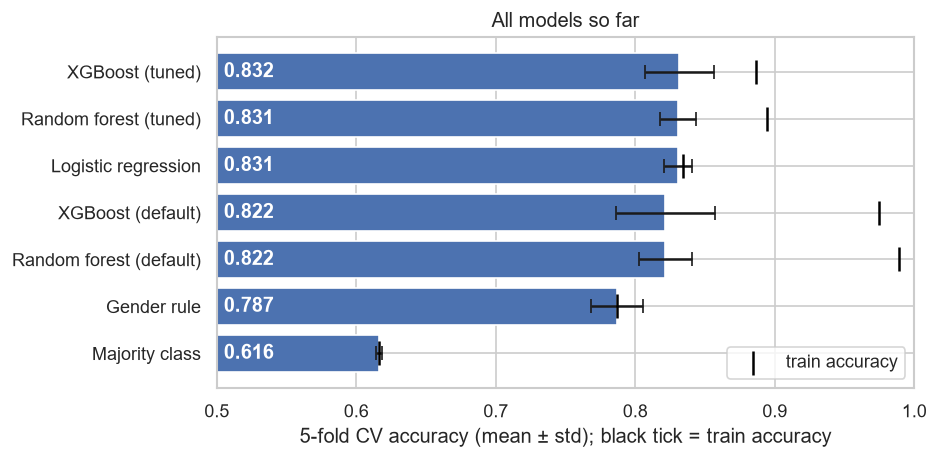
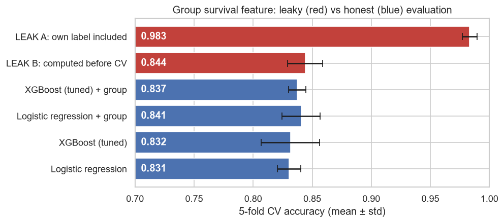
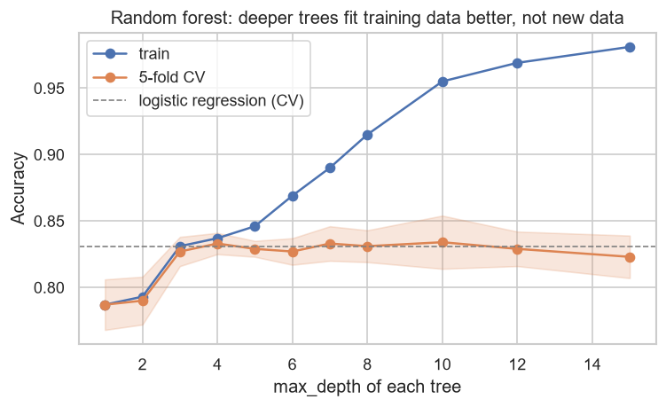

# Titanic: Machine Learning from Disaster

End-to-end tabular ML project on the Kaggle
[Titanic](https://www.kaggle.com/competitions/titanic) competition:
predict which passengers survived the sinking (binary classification, scored by accuracy).

> Work in progress. This README is filled in as each step is finished.

## Approach

| Step | Status | Where |
|---|---|---|
| 1. Exploratory data analysis | done | `notebooks/01_eda.ipynb` |
| 2. Baseline (logistic regression) | done | `notebooks/02_baseline.ipynb` |
| 3. Tree models (Random Forest, XGBoost) | done | `notebooks/03_trees.ipynb` |
| 4. New feature: group survival (leak-free) | done | `notebooks/04_group_features.ipynb` |
| 5. Kaggle submission | done | `submissions/` |

## Results

5-fold stratified cross-validation on the 891 training passengers, the same folds for every model.
All learned preprocessing (age imputation by title, scaling, one-hot encoding) runs inside a scikit-learn
`Pipeline`, so it is fitted on the training folds only. Tree model hyperparameters are tuned with nested
cross-validation, so the reported score is not inflated by the search.

| Model | CV accuracy (mean ± std) | Train accuracy | Kaggle public score |
|---|---|---|---|
| Majority class ("everyone died") | 0.616 ± 0.002 | 0.616 | |
| Gender rule ("women survived") | 0.787 ± 0.019 | 0.787 | |
| Logistic regression | 0.831 ± 0.010 | 0.834 | 0.76555 |
| Random forest (default) | 0.822 ± 0.019 | 0.989 | |
| XGBoost (default) | 0.822 ± 0.036 | 0.975 | |
| Random forest (tuned) | 0.831 ± 0.013 | 0.895 | |
| XGBoost (tuned) | 0.832 ± 0.025 | 0.886 | 0.77033 |
| Logistic regression + group survival | 0.841 ± 0.016 | (inflated) | **0.79425** |
| XGBoost (tuned) + group survival | 0.837 ± 0.007 | (inflated) | 0.78947 |



The group survival feature is the survival rate of the *other* known passengers sharing a ticket or family.
It is built from the target, so it is fitted inside the Pipeline with leave-one-out on the training rows.
Train accuracy for these models includes each passenger's own label and is not comparable.



## Key findings so far

- Gender, ticket class and the title in the passenger's name are the strongest signals.
- Logistic regression beats the gender rule on every fold, with no sign of overfitting (train 0.834).
- Tree ensembles with default settings memorise the training data (train 0.98–0.99) and score lower on new
  passengers. Tuned, they tie with logistic regression: fold-by-fold differences go both ways and are smaller
  than the fold-to-fold noise.
- Trees did not fix the groups logistic regression gets wrong (women in 3rd class, men in 1st class). With these
  features ~83% looks like a ceiling; further gains need new information, not a more flexible model.
- On Kaggle both models score about 6 points below their CV accuracy (0.766 and 0.770). The 0.5-point gap
  between them is one or two passengers, well within the noise, so it does not change the conclusion that
  they are equally good. The drop from CV to the leaderboard is the more useful signal: the CV estimate is
  optimistic for this test set.
- New information moves the plateau: the group survival feature lifts logistic regression to 0.841 and is never
  worse on any fold. It mostly helps women in 3rd class whose family perished (accuracy 65% → 74%).
  On Kaggle the gain is larger than in CV: logistic regression goes from 0.766 to 0.794 (+2.9 points, about
  12 test passengers) and XGBoost from 0.770 to 0.789. The test set has known group members slightly more
  often than the validation folds (41% vs 37%), which fits a larger gain there.
- Leakage demo: computing the same feature carelessly gives 0.983 (own label included) or 0.844 (computed before
  CV). The second is only 0.3 points above the honest score, which is exactly why it would go unnoticed.



## Project structure

```
kaggle-titanic/
├── data/
│   ├── raw/            # train.csv, test.csv from Kaggle (not committed)
│   └── processed/
├── notebooks/          # numbered notebooks, run in order
├── reports/figures/    # figures used in this README
├── src/titanic/        # data loading and feature pipeline
├── submissions/        # CSV files sent to Kaggle
└── requirements.txt
```

## How to run

```bash
python -m venv .venv
.venv\Scripts\activate          # Windows
pip install -r requirements.txt
```

Download the data from the
[competition data page](https://www.kaggle.com/competitions/titanic/data)
(you need to join the competition first) and put `train.csv` and `test.csv` into `data/raw/`.
Then open the notebooks in order and select the `.venv` interpreter.
